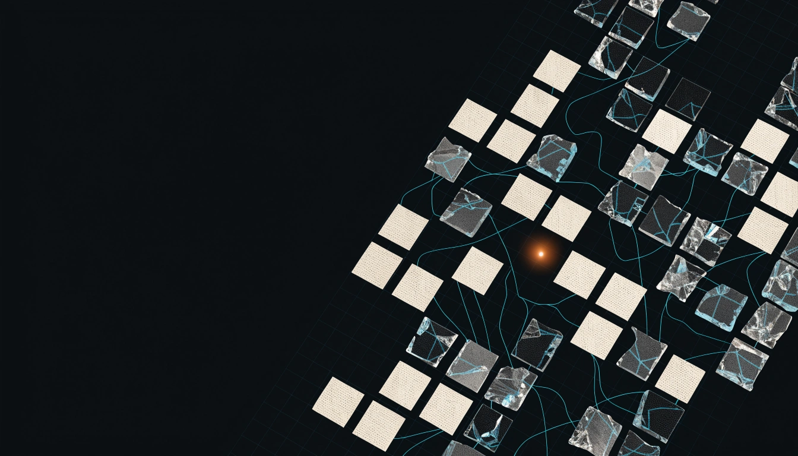
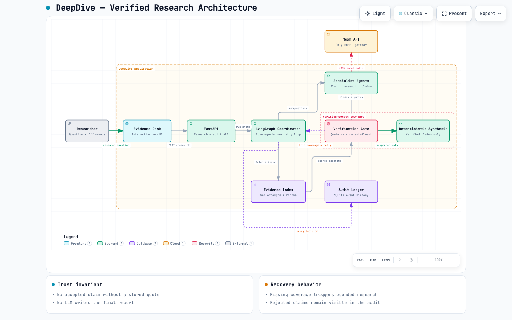
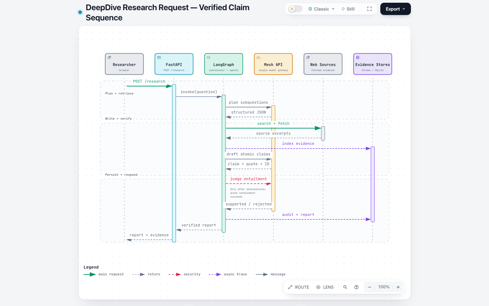
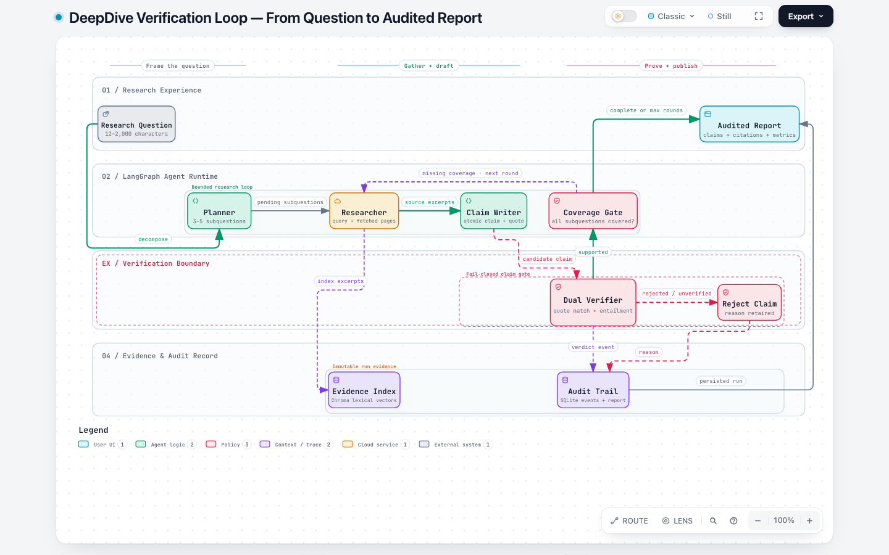
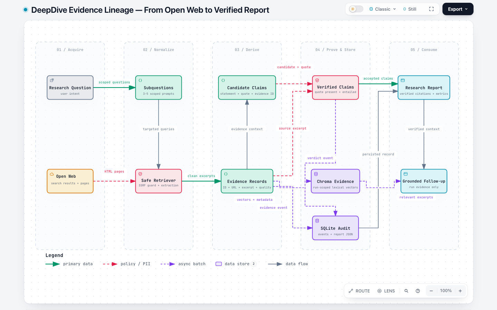

# DeepDive — Self-Verifying Research Analyst

> **Agent Arena 2026 — Track 01 Submission**  
> Built with **LangGraph**, **ChromaDB**, **SQLite**, and **Mesh API** (mandatory gateway).

[](https://abh2050.github.io/deepdive-agent-arena-2026/)

[](https://github.com/abh2050/deepdive-agent-arena-2026/actions/workflows/unit-tests.yml)
[](https://github.com/abh2050/deepdive-agent-arena-2026/actions/workflows/agent-arena-2026-checks.yml)
[](https://deepdive-agent-arena-2026.vercel.app/)
[](https://abh2050.github.io/deepdive-agent-arena-2026/)

**[Launch the live interactive app →](https://deepdive-agent-arena-2026.vercel.app/)**

[Explore the project showcase and system atlas →](https://abh2050.github.io/deepdive-agent-arena-2026/)

DeepDive is a multi-agent research analyst designed from the ground up to solve the **trust and hallucination problem** in AI-generated research. Instead of treating citation generation as a cosmetic step or relying on a single long prompt, DeepDive enforces **hard, auditable verification boundaries**:
1. Every candidate claim must cite a real, fetched evidence ID and contain a **verbatim quote** extracted directly from that source excerpt.
2. A separate **Mesh-routed Verifier** independently judges semantic entailment before any claim is accepted.
3. If evidence is thin or missing for a subquestion, the system **loops back via LangGraph to research more** rather than padding the output.
4. Final reports are composed **deterministically** — an LLM cannot introduce unverified facts during synthesis.

---

## 🏛️ Interactive System Atlas

Four validated Archify views explain the system from complementary angles. Click any preview to open the full interactive diagram with light/dark themes, relationship tracing, guided lenses, repository evidence, search, and export.

### System architecture

[](https://abh2050.github.io/deepdive-agent-arena-2026/assets/deepdive-architecture.html)

The topology view maps the user-facing desk, FastAPI boundary, LangGraph coordinator, mandatory Mesh gateway, evidence stores, verifier, bounded retry, and deterministic synthesis.

### Research request sequence

[](https://abh2050.github.io/deepdive-agent-arena-2026/assets/deepdive-sequence.html)

The sequence view follows a single request across the browser, API, coordinator, Mesh, web sources, and persistent stores—including the exact point where deterministic quote containment precedes semantic entailment.

### Verification workflow

[](https://abh2050.github.io/deepdive-agent-arena-2026/assets/deepdive-workflow.html)

The workflow view makes the fail-closed claim gate, rejection path, audit trail, and bounded coverage retry explicit.

### Evidence data flow

[](https://abh2050.github.io/deepdive-agent-arena-2026/assets/deepdive-dataflow.html)

The lineage view shows how untrusted pages become normalized evidence records, candidate claims, verified claims, persisted audit events, final reports, and grounded follow-ups.

---

## 🤖 Exact Agent Architecture

DeepDive has one primary LangGraph research workflow and one separate follow-up path. The primary graph contains exactly three orchestration nodes:

```text
START
  → plan
  → research_and_verify
      ↳ retry research_and_verify while any subquestion has no supported claim
        and round_id < MAX_RESEARCH_ROUNDS
  → synthesize
  → END
```

`research_and_verify` is a composite graph node. For each still-uncovered subquestion, it calls the Researcher, stores the returned evidence, calls the ClaimWriter, and sends each new candidate claim through the Verifier. These operations are sequential in the current implementation; the specialist classes are not separate LangGraph nodes.

The components and their exact responsibilities are:

| Component | Model-backed? | Where it runs | Exact responsibility and boundary |
| :--- | :---: | :--- | :--- |
| **Coordinator** | No | Primary LangGraph workflow | Owns graph state, audit events, the coverage test, and the bounded retry. A subquestion counts as covered only when at least one claim for it has a `supported` verdict. It retries only uncovered subquestions and stops after `MAX_RESEARCH_ROUNDS` total rounds. |
| **Planner** | Yes, through Mesh | `plan` node | Requests 3–5 non-overlapping, answerable subquestions. The code keeps at most five non-empty strings, truncates each to 300 characters, and fails the run if none remain. |
| **Researcher** | Yes, through Mesh, plus deterministic web retrieval | `research_and_verify` node | Asks the model for one search query per pending subquestion, then passes that query to `WebRetriever`. On retries, the prompt asks for missing primary evidence or alternate credible sources. It does not invent or directly fetch sources itself. |
| **WebRetriever** | No | Called by Researcher | Tries DuckDuckGo text search; if that returns no items, DuckDuckGo News; if neither returns items, Wikipedia full-text search. It accepts only HTTP(S) URLs that pass SSRF checks, revalidates the final redirect URL, fetches HTML, removes common non-content elements, truncates extracted text to 8,500 characters, assigns a heuristic domain-quality score, and returns at most `SEARCH_RESULTS_PER_QUERY` evidence records. |
| **ClaimWriter** | Yes, through Mesh | `research_and_verify` node | Requests up to five atomic candidate claims for one subquestion. Each candidate must include a statement, a non-empty quote, and an evidence ID present in that call's supplied evidence. This stage validates those fields and the ID, but it does not itself prove that the quote occurs in the excerpt. |
| **Verifier** | Partly | `research_and_verify` node, after ClaimWriter | First performs an exact, case-sensitive Python substring check: `claim.quote` must occur in the stored evidence excerpt. Only then does a separate Mesh call judge whether the passage directly supports the entire claim. Only `supported` claims enter the accepted set; `rejected` and `unverified` claims are retained in the report's rejection records and excluded from the narrative. |
| **ContradictionDetector** | Yes, through Mesh | Beginning of `synthesize`, after the retry loop | Examines accepted claims within each subquestion and proposes conflicting claim IDs. The Coordinator keeps a proposal only when it resolves to at least two already-accepted claims from at least two evidence IDs. Model-written discrepancy descriptions are discarded; the report renders only the verified claim statements and evidence IDs selected by that validation. |
| **Synthesizer** | No | `synthesize` node | Deterministically formats accepted claim statements and their source URLs into Markdown, marks per-subquestion coverage, adds validated cross-source comparisons, computes metrics, saves the report, and logs completion. It makes no model call and cannot add new factual prose from a model. |
| **FollowUpAgent** | Yes, through Mesh | Separate `POST /runs/{id}/followup` request; not in the LangGraph workflow | Loads the saved report (or the report supplied in the request). Locally it queries Chroma with a deterministic hashed lexical vector filtered by `run_id`; on Vercel, where Chroma is disabled, or if lookup fails, it falls back to the first four report evidence excerpts. It asks the model to answer only from the verified-claim summary and selected excerpts with evidence-ID citations. If that call fails, the code returns a generic fallback pointing to up to three verified evidence IDs rather than generating a new factual answer. |

All model-backed components use the single client boundary in `app/mesh.py`. Live mode sends those calls to the Mesh-compatible base URL. Demo mode substitutes `SimulationMeshLLM`, a deterministic local simulator, while using the same component interfaces. Web retrieval, deterministic checks, storage, lexical vectorization, graph routing, and synthesis are not model calls.

---

## 📊 Self-Evaluation Results

DeepDive includes a built-in benchmark runner ([`evaluation/run_eval.py`](evaluation/run_eval.py)) tested on the predeclared challenge questions in [`evaluation/questions.json`](evaluation/questions.json).

### Live Mesh Benchmark Metrics ([`evaluation/results.json`](evaluation/results.json))

These checked-in results were produced with live web retrieval and all agent calls routed through Mesh API. The deliberately strict verifier rejected unsupported or overstated candidates instead of optimizing for a cosmetically high pass rate.

| Benchmark ID | Research Question | Attempted Claims | Verified Claims | Verification Pass Rate | Subquestion Coverage | Bounded Retries |
| :--- | :--- | :---: | :---: | :---: | :---: | :---: |
| `ev_market` | What major supply-chain risks affected EV batteries in 2025 and 2026? | 32 | 9 | **28.1%** | **100%** | 1 (Under-supported retry triggered) |
| `heat_pumps` | What evidence supports and limits the energy savings of residential heat pumps? | 25 | 16 | **64.0%** | **80.0%** | 1 (Under-supported retry triggered) |
| `grid_storage` | What are the main grid-scale battery storage safety and reliability risks? | 12 | 9 | **75.0%** | **60.0%** | 1 (Under-supported retry triggered) |

*In local mode, audit trails for evaluation runs are appended to `deepdive.sqlite3` and are viewable through the web interface. In Vercel mode, the `/research` response includes that request's audit events because local serverless files are not guaranteed to persist across instances.*

---

## 🌟 Highlighted Bonus Features

1. **Structured LangGraph Orchestration with Real Retries**:
   - Explicit `StateGraph` nodes with conditional edges (`plan → research_and_verify → (retry \| synthesize)`).
   - If any subquestion lacks verified claims, the graph initiates a bounded re-search (`MAX_RESEARCH_ROUNDS = 2`).
2. **Contradiction Detection Across Sources**:
   - Compares multi-source claims per topic to identify divergent numbers, dates, or opposing conclusions rather than silently picking one.
3. **Transparent Source-Quality Weighting**:
   - Domain heuristic scores: `.gov` and `.edu` (0.95), global agencies (`who.int`, `iea.org`, `sec.gov`) (0.95), non-profits (`.org`) (0.7), and commercial/media (0.5).
   - Displayed in the visual Evidence Inspector alongside trust meters.
4. **Conversational Follow-Up Agent (`POST /runs/{id}/followup`)**:
   - Locally queries ChromaDB with deterministic hashed lexical vectors (`where={"run_id": id}`); Vercel and lookup-failure paths use evidence carried in the saved or request-supplied report.
5. **Interactive Single-Page Web Dashboard**:
   - Dark-mode glassmorphic interface with interactive DAG pipeline visualizer, live metrics strip, clickable citation badges, evidence inspector drawer, SQLite audit trail explorer, and one-click PDF/Print export.
6. **Robust Web Retrieval & Anti-Bot Fallback**:
   - Seamless fallback hierarchy (DuckDuckGo Text → DuckDuckGo News → Wikipedia Full-Text Search API) to prevent rate limits from stopping research.
   - Redirect-following with post-redirect SSRF host validation.

## 🧩 Key Design Decisions

- **Verification is a hard boundary:** a candidate cannot reach the report unless its quote exists verbatim in the stored excerpt and the separate verifier accepts full-claim entailment.
- **Synthesis is deterministic:** accepted claims are formatted by Python, preventing a final writing pass from adding uncited facts.
- **Retries are coverage-driven and bounded:** missing subquestion coverage loops back to targeted research without creating an unbounded agent run.
- **Contradictions retain verified wording:** the detector may nominate claim IDs, but the Coordinator requires multiple accepted claims from multiple evidence IDs and never copies the detector's free-form prose into the report.
- **Model access has one choke point:** generative calls are created only in `app/mesh.py`, using the mandatory Mesh-compatible base URL.

---

## 🚀 Getting Started

### Live Vercel deployment

The repository includes a Vercel-native FastAPI entrypoint and Fluid Compute
configuration. Import the repository in Vercel, add `MESH_API_KEY` to the
Production, Preview, and Development environments, and deploy. The hosted mode
returns audit events with each report and sends report context with follow-ups,
so the core judging experience does not depend on one serverless instance
retaining local files. Local development continues to use SQLite and ChromaDB.

Do not add `SUBMISSION_TOKEN` to Vercel; that secret belongs only in GitHub
Actions.

### Prerequisites
- Python 3.11+
- Git

### 1. Installation
```bash
# Clone the repository
git clone https://github.com/abh2050/deepdive-agent-arena-2026.git
cd deepdive-agent-arena-2026

# Create and activate virtual environment
python3.11 -m venv .venv
source .venv/bin/activate  # Windows: .venv\Scripts\activate

# Install dependencies
pip install -r requirements.txt

# Configure environment variables
cp .env.example .env
```

### 2. Configure Credentials (`.env`)
```env
MESH_API_KEY=rsk_your_mesh_api_key_here
MESH_MODEL=openai/gpt-4o
DATABASE_PATH=deepdive.sqlite3
MAX_RESEARCH_ROUNDS=2
SEARCH_RESULTS_PER_QUERY=4
CHROMA_PATH=./data/chroma
```

*(Note: DeepDive includes an offline simulation engine — you can launch the app and test the full end-to-end research workflow even before setting your Mesh key!)*

### 3. Run the Web Application
```bash
uvicorn app.main:app --reload --port 8000
```
- Open [http://localhost:8000](http://localhost:8000) for the **Interactive Research Dashboard**.
- Open [http://localhost:8000/docs](http://localhost:8000/docs) for the **FastAPI Swagger API Documentation**.

---

## 🧪 Testing & Evaluation

### Run Offline Unit & API Tests
```bash
pytest -v
```
All tests run with zero external network or model requirements:
- `tests/test_api.py::test_health` — Health check endpoint.
- `tests/test_api.py::test_config` — Public safe configuration endpoint.
- `tests/test_api.py::test_evaluation_questions` — Track 01 benchmark dataset availability.
- `tests/test_api.py::test_research_demo_mode` — Full end-to-end research, reporting, audit trail, and follow-up query.
- `tests/test_workflow.py::test_rejects_unsupported_and_missing_quote` — Verifier rejects claims with missing quotes or unsupported assertions.
- `tests/test_workflow.py::test_insufficient_evidence_triggers_bounded_retry` — Confirms LangGraph bounded research retry loop.

### Run Benchmark Suite
```bash
python -m evaluation.run_eval
```

---

## 📡 API Reference

| Method | Endpoint | Description |
| :--- | :--- | :--- |
| `GET` | `/` | Serves the interactive DeepDive web dashboard. |
| `GET` | `/health` | Service health status (`{"status":"ok"}`). |
| `GET` | `/config` | Non-sensitive runtime configuration and Mesh key status. |
| `POST` | `/research` | Executes multi-agent research on a question (`{"question":"..."}`). |
| `GET` | `/runs` | Lists recent research runs with metrics and timestamps. |
| `GET` | `/runs/{id}` | Retrieves full JSON report, claims, evidence, and coverage for a run. |
| `GET` | `/runs/{id}/audit` | Retrieves the SQLite audit-event rows recorded for a locally available run. |
| `GET` | `/runs/{id}/report.md` | Downloads the clean Markdown report. |
| `POST` | `/runs/{id}/followup` | Asks a follow-up using the saved or request-supplied report; local mode also attempts run-filtered Chroma retrieval. |
| `GET` | `/evaluation/questions`| Returns Track 01 benchmark questions. |
| `POST` | `/evaluation/run` | Triggers evaluation suite execution. |

Provider failures use an application-owned response shape instead of exposing the
changing text returned by Mesh or its upstream model providers:

```json
{
  "detail": {
    "code": "mesh_rate_limited",
    "message": "Mesh is temporarily rate-limiting requests. Please retry shortly.",
    "retryable": true
  }
}
```

The stable codes cover authentication, credits, rate limits, timeouts, outages,
invalid model responses, and unclassified request failures. Classification is
based on HTTP status and SDK exception type, not fragile provider message text.

---

## 🔒 Hackathon & CI Compliance

- **Mandatory Mesh Routing**: All generative model calls route strictly through `https://api.meshapi.ai/v1` in [`app/mesh.py`](app/mesh.py).
- **Official GitHub Actions Workflow**: Configured at [`.github/workflows/agent-arena-2026-checks.yml`](.github/workflows/agent-arena-2026-checks.yml).
  Genuine technical failures remain blocking. Until the dashboard form is
  submitted, the organizer's expected “entry not submitted” response appears
  as a warning because there is no submission record to update yet.
- **Required GitHub Secrets**:
  - `MESH_API_KEY`: Your Mesh API key starting with `rsk_`.
  - `SUBMISSION_TOKEN`: Your hackathon submission token from the dashboard.
- **Git Hygiene**: `.env` and local database artifacts are strictly gitignored via [`.gitignore`](.gitignore).
